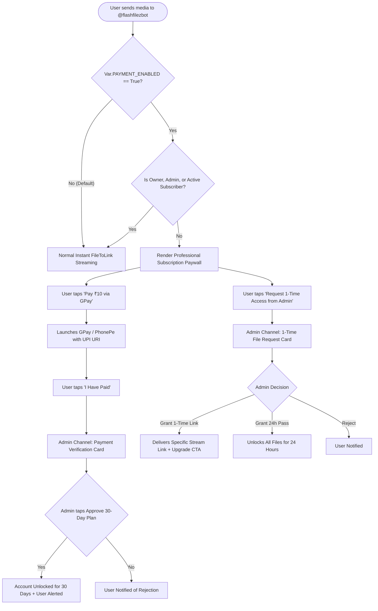

# Architectural Plan: Flash File Dual-Mode Access & ₹10/Month Subscription Engine

> [!NOTE]
> **Environment Guardrail**: This entire system remains strictly dormant when `PAYMENT` (or `Payment`) is unset or `False`. When disabled, the bot operates with **zero modifications** to its current free streaming pipeline. Only when `PAYMENT=True` is explicitly configured does the dual-mode gateway activate.

---

## 1. System Architecture & Dual Flow



---

## 2. Configuration & Safe Fallback (`Thunder/vars.py`)

All payment configurations are isolated with safe defaults:

```python
# Payment & Subscription Configuration
PAYMENT_ENABLED: bool = str_to_bool(os.getenv("PAYMENT", os.getenv("Payment", "False")))
SUB_PRICE: int = int(os.getenv("SUB_PRICE", "10"))
UPI_ID: str = os.getenv("UPI_ID", "jishnupg2005-2@okaxis").strip()
UPI_NAME: str = os.getenv("UPI_NAME", "Flash File").strip()
ADMIN_CHANNEL: int = int(os.getenv("ADMIN_CHANNEL", os.getenv("PAYMENT_LOG_CHANNEL", "0")))
```

> [!IMPORTANT]
> If `ADMIN_CHANNEL` is `0` or unset, approval cards automatically route directly to the Bot Owner's private chat (`Var.OWNER_ID`), ensuring 100% operational reliability with zero mandatory channel setup.

---

## 3. Database Schema & Persistence (`Thunder/utils/database.py`)

A new dedicated collection `subscriptions` in MongoDB tracks active memberships:

```json
{
  "_id": 123456789,
  "user_name": "Jishnu",
  "plan": "premium_monthly",
  "amount_paid": 10,
  "subscribed_at": "2026-10-31T13:20:00Z",
  "expires_at": "2026-11-30T13:20:00Z",
  "is_active": true,
  "payment_method": "UPI_GPay",
  "history": [
    {
      "tx_id": "SUB-123456789-1730380800",
      "granted_by": "admin",
      "days": 30,
      "date": "2026-10-31T13:20:00Z"
    }
  ]
}
```

### Key DB Methods
1. `is_subscribed(user_id: int) -> bool`: Checks whether user has an active, non-expired subscription.
2. `get_subscription(user_id: int) -> Optional[dict]`: Retrieves expiration date and remaining days.
3. `add_subscription(user_id: int, days: int = 30) -> datetime`: Extends or creates a subscription from current time (or extends existing active expiry).
4. `remove_subscription(user_id: int) -> bool`: Immediately revokes access.
5. `get_subscribers_summary() -> dict`: Counts active paying subscribers and calculated monthly revenue.

---

## 4. User Interface & Professional Typography

### A. The User Paywall Message
Presented when an unsubscribed user sends a media file in private chat:

```markdown
✨ **Flash File Premium Access** ✨

📁 **File:** `Deadpool & Wolverine (2024).mkv`
📦 **Size:** `1.84 GB` | ⏱️ **Duration:** `02:07:31`

━━━━━━━━━━━━━━━━━━━━━━━━
To access high-speed streaming, unlimited file conversions, and direct multi-thread downloads, activate your **Flash File Pass**.

💎 **Monthly Membership:** **₹10 / Month**
• Unlimited video streaming & zero buffer delay
• Dedicated high-bandwidth cloud workers
• Batch conversions & permanent links

━━━━━━━━━━━━━━━━━━━━━━━━
👇 **Select an option below to proceed:**
```

**Inline Buttons:**
```
[ 📱 Pay ₹10 via Google Pay / UPI ] (UPI Intent Deep Link)
[ 📩 Request 1-Time Access from Admin ] (Triggers Admin Card)
[ ⚡ I Have Completed Payment ] (Triggers Verification Notification)
[ ℹ️ Learn More & Help ]
```

### B. UPI Deep Link Specification
The payment button uses the standard NPCI UPI Intent protocol:
```
upi://pay?pa=jishnupg2005-2@okaxis&pn=Flash%20File&am=10&cu=INR&tn=FlashFile_Sub_{user_id}
```
* On Android: Directly invokes the UPI App Selector (Google Pay, PhonePe, Paytm, BHIM, Cred) with the receiver name, UPI ID, and exact ₹10 amount locked in.
* Note contains `FlashFile_Sub_{user_id}` for instant cross-referencing.

---

## 5. Admin Management Cards (Telegram Channel / Owner DM)

### Card A: Subscription Payment Approval Card
Fired when a user taps *"⚡ I Have Completed Payment"*:

```markdown
💎 **New Subscription Payment Request**

👤 **Subscriber:** [Jishnu](tg://user?id=123456789)
🆔 **User ID:** `123456789`
💰 **Plan:** **₹10.00 / 30 Days**
🏦 **UPI Reference:** `FlashFile_Sub_123456789`
🕒 **Submitted:** `31 Oct 2026, 01:25 PM UTC`

━━━━━━━━━━━━━━━━━━━━━━━━
Verify the credit in your Google Pay account, then select an action:
```

**Action Buttons:**
```
[ ✅ Approve (30 Days Pass) ]   [ 🎁 Grant 7 Days Trial ]
[ ❌ Decline Request ]          [ 👤 View Profile ]
```

* Clicking `[ ✅ Approve (30 Days Pass) ]`:
  1. Updates the message in the channel to: `✅ Approved by Admin (30 Days granted to Jishnu)`.
  2. Extends user's DB record by 30 days.
  3. Sends an instant celebration alert to the user:
     > *"🎉 **Payment Verified!** Your 30-Day Flash File Premium membership is now active until **30-Nov-2026**. Enjoy unlimited streaming!"*

---

### Card B: 1-Time Temporary File Access Card
Fired when the user requests a temporary pass for a specific movie:

```markdown
🎬 **Temporary File Access Request**

👤 **Requester:** [Alex](tg://user?id=987654321) (`@alex`)
🆔 **User ID:** `987654321`
📁 **Media:** `Interstellar (2014) IMAX 1080p.mkv`
📦 **Size:** `2.45 GB`

━━━━━━━━━━━━━━━━━━━━━━━━
Authorize free link delivery or invite them to subscribe:
```

**Action Buttons:**
```
[ 🚀 Grant This File Only ]   [ 🎁 Grant 24h Free Pass ]
[ ❌ Reject Request ]
```

* Clicking `[ 🚀 Grant This File Only ]`:
  1. The bot forwards the media to the bin channel, generates the canonical streaming & download links, and sends them directly to the user with an upgrade banner:
     > *"🎁 **Free Access Granted!** Here is your stream link for **Interstellar (2014)**.\n\nEnjoy the movie! To stream all movies without waiting for admin approval, [Subscribe for ₹10/month]."*
  2. Updates admin card: `🚀 Granted 1-Time Access by Admin`.

---

## 6. Admin & User Command Suite

| Command | Permission | Description |
| :--- | :--- | :--- |
| `/plan` or `/myplan` | All Users | Displays current subscription status, plan name, and exact days remaining. |
| `/subscribe` or `/buy` | All Users | Opens the ₹10 subscription dialog with the instant GPay payment link. |
| `/addsub <user_id> [days]` | Owner / Admin | Manually assigns or extends a subscription (default: 30 days). |
| `/remsub <user_id>` | Owner / Admin | Immediately cancels and removes a user's subscription. |
| `/subscribers` | Owner / Admin | Shows total active paying members, expiring soon counts, and total revenue. |

---

## 7. Implementation Checklist

- [ ] **Step 1:** Add environment variables & types in [`Thunder/vars.py`](file:///data/antigravity/Jellyfin/Thunder/vars.py) (`PAYMENT_ENABLED`, `SUB_PRICE`, `UPI_ID`, `ADMIN_CHANNEL`).
- [ ] **Step 2:** Implement subscription methods in [`Thunder/utils/database.py`](file:///data/antigravity/Jellyfin/Thunder/utils/database.py).
- [ ] **Step 3:** Create dedicated plugin [`Thunder/bot/plugins/subscription.py`](file:///data/antigravity/Jellyfin/Thunder/bot/plugins/subscription.py) containing all commands, callbacks, and notification dispatchers.
- [ ] **Step 4:** Integrate gating logic in [`Thunder/bot/plugins/stream.py`](file:///data/antigravity/Jellyfin/Thunder/bot/plugins/stream.py) (strict zero-change bypass if `PAYMENT_ENABLED == False`).
- [ ] **Step 5:** Add professional notification templates in [`Thunder/utils/messages.py`](file:///data/antigravity/Jellyfin/Thunder/utils/messages.py).
- [ ] **Step 6:** Validate with unit tests and push to GitHub and Hugging Face spaces.
