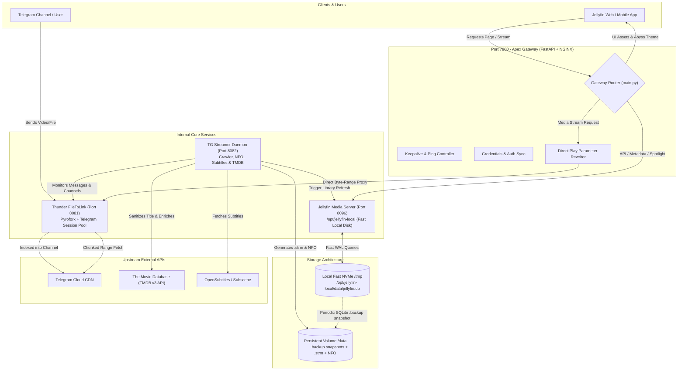

# Comprehensive Architecture, Build Specification & Upgrade Summary
**Project:** Jellyfin + Thunder FileToLink + Apex Streaming Ecosystem  
**Target Environment:** Hugging Face Spaces (Docker / Debian Bookworm) & Local Development  
**Last Updated:** October 2026  
**Document Purpose:** Master technical reference and architectural guide for engineering handoff and autonomous AI agent operations.

---

## 1. Executive Summary & Vision

The project transforms a distributed Telegram media storage ecosystem into a high-performance, private, zero-transcode Netflix/Apple TV-grade streaming platform powered by **Jellyfin**. Instead of hosting gigabytes or terabytes of video files on costly cloud storage, media files reside in Telegram channels/groups. A lightweight supervisor orchestrates:
1. **Thunder (FileToLink Bot)**: A Pyrofork/aiohttp bot converting Telegram document streams into persistent HTTP byte-range stream endpoints.
2. **Apex Gateway**: A high-throughput FastAPI reverse proxy multiplexing client traffic, intercepting Jellyfin playback requests, enforcing direct stream playback, and hosting the custom UI additions.
3. **Apex Stream Engine**: An asynchronous streaming pipeline featuring byte-range multiplexing, inflight request deduplication, connection pooling, and multi-tier LRU caching.
4. **Metadata & Subtitle Pipeline**: An automated metadata crawler utilizing TMDB, title sanitization, AI-assisted disambiguation heuristics, and OpenSubtitles/Subscene integrations.
5. **Abyss UI & Spotlight Hero Banner**: A custom streaming client skin with ambient backdrops, clear logo branding, and zero-storage in-app trailer playback.
6. **Resilient Self-Healing & Persistence Subsystem**: A supervisor layer overcoming Hugging Face Spaces network storage SQLite file locking limitations through dual-tier local/persistent database backups and boot-time database self-repair.



---

## 2. Port Topology & Routing Architecture

Hugging Face Spaces exposes a single external HTTP port: **`7860`**. The gateway acts as the single pane of glass, routing traffic internally:

| Port | Service | Process / Technology | Access & Role |
| :--- | :--- | :--- | :--- |
| **`7860`** | **Apex Gateway** | FastAPI + Uvicorn / NGINX | **Public Entrypoint**. Intercepts all client requests, routes to Jellyfin or FileToLink, strips transcode parameters. |
| **`8096`** | **Jellyfin Core** | Jellyfin Server (.NET Core) | **Internal Only**. Operates on local storage (`/opt/jellyfin-local`) for metadata, library indexing, and user state. |
| **`8081`** | **Thunder (FileToLink)** | Python `aiohttp` / Pyrofork | **Internal Only**. Translates stream URLs (`/stream/{msg_id}`) into raw Telegram byte ranges. |
| **`8082`** | **TG Streamer** | Async Python HTTP Server | **Internal Only**. Exposes health, trigger-scan, and dynamic `.strm` generation hooks. |

### Routing Decision Tree (`apex/gateway/main.py`)
1. `/jellyfin/web/*`, `/web/*`, `/ui/*` $\rightarrow$ Serves Jellyfin Web Client injected with **Abyss Theme** and **Spotlight Hero Banner**.
2. `/Items/*/Images/*` $\rightarrow$ Proxied to Jellyfin (with in-memory caching and fallback handlers for logos and backdrops).
3. `/Videos/*/stream`, `/stream/*`, `/dl/*` $\rightarrow$ Strips transcoding parameters (`TranscodingMaxAudioChannels`, `VideoCodec`, etc.), rewritten directly to FileToLink (`http://127.0.0.1:8081`) with `Range` header preservation for instant seek.
4. `/status`, `/health`, `/ping` $\rightarrow$ Responded to locally or forwarded to prevent external watchdog idle shutdowns.

---

## 3. Directory Structure & Key File Map

```text
c:\Users\JISHNU PG\Music\JellyFin\FileToLink\
├── Dockerfile                      # Debian Bookworm container definition (Jellyfin, Python 3.11/3.13, ffmpeg)
├── combined-entrypoint.sh          # Master container entrypoint: boots Thunder, delegates to Apex
├── requirements.txt                # Python dependencies (aiohttp, pyrofork, fastapi, uvicorn, pytest, etc.)
├── Thunder/                        # Telegram Bot engine (FileToLink)
│   ├── __main__.py                 # Telegram bot client initialization & aiohttp web server startup
│   ├── vars.py                     # Environment variable parsing (API_ID, BOT_TOKEN, BIN_CHANNEL, etc.)
│   ├── bot/                        # Pyrofork handlers for commands, admin tools, and channel monitoring
│   └── server/
│       ├── stream_routes.py        # HTTP Byte-Range media streaming handler from Telegram CDN
│       └── exceptions.py           # Custom streaming exceptions (InvalidRange, StreamExhausted)
└── apex/                           # Core Gateway, Streaming Engine, UI, and Self-Healing Subsystem
    ├── combined-entrypoint.sh      # Dual-tier database setup, symlink redirects, library repair, supervisor
    ├── health_doctor.py            # Diagnostic monitor (disk space, DB locks, keepalive, bot health)
    ├── repair_jellyfin_libraries.py# Automated database healing, mismatch purging, subtitle cleanup
    ├── tg_streamer.py              # Main media organizer, TMDB enrichment, .strm creator, logo processor
    ├── pytest.ini                  # Pytest configuration with asyncio and timeout plugins
    ├── apex_stream/                # High-performance streaming library
    │   ├── cache.py                # Thread-safe LRU buffer cache for media stream segments
    │   ├── errors.py               # Stream-specific exception hierarchy
    │   ├── inflight.py             # Single-flight deduplication: shared chunks across concurrent clients
    │   ├── media_catalog.py        # SQLite catalog tracking Telegram message IDs to media paths
    │   ├── organize.py             # Language, title, year, noise parsing (e.g. Malayalam, Hindi, English)
    │   ├── pool.py                 # Multi-client connection pooling for Telegram sessions
    │   ├── ranges.py               # HTTP Range header parsing and multi-part byte calculations
    │   ├── stream.py               # Chunked async response generator for client video players
    │   ├── subtitles.py            # Extraction, download, cleaning, sync, and VTT/SRT normalization
    │   └── tmdb_meta.py            # TMDB metadata fetcher, candidate scoring, AI-assisted disambiguation
    ├── gateway/                    # Reverse Proxy Subsystem
    │   ├── main.py                 # FastAPI application, route interception, direct play rewriting
    │   ├── ops.py                  # Stream proxy implementation and direct client piping
    │   ├── jellyfin.py             # Jellyfin client API communication helper
    │   └── credentials_sync.py     # Auto-synchronization of API tokens between Jellyfin & Gateway
    ├── tests/                      # Automated Test Suite (242 Unit & Integration Tests)
    │   ├── test_cache.py           # Tests for LRU memory caching
    │   ├── test_inflight.py        # Tests for concurrent consumer stream sharing
    │   ├── test_media_catalog.py   # Tests for catalog persistence and state updates
    │   ├── test_media_naming.py    # Tests for title noise removal and normalization
    │   ├── test_repair_jellyfin_libraries.py # Tests for DB healing, orphan deletion, mismatch purge
    │   ├── test_subtitles.py       # Tests for subtitle parsing, encoding conversion, and cleanup
    │   └── test_tmdb_meta.py       # Tests for candidate disambiguation and TMDB scoring
    └── ui/                         # Premium Streaming UI Addons
        ├── abyss.css               # Modern dark-mode streaming skin for Jellyfin Web
        ├── spotlight.html          # Netflix-style interactive hero banner widget
        ├── spotlight.css           # Styling, transitions, responsive layout for Spotlight
        └── spotlight-loader.js     # Head injection script hooking into Jellyfin Angular/Vue routing
```

---

## 4. Key Architectural Subsystems & Innovations

### A. The Dual-Tier SQLite Persistence Engine
* **The Problem:** Hugging Face Spaces persistent storage (`/data`) runs on network-attached storage (NFS/gluster). SQLite locks over NFS fail with `SQLite Error 10: disk I/O error` when Jellyfin makes frequent concurrent reads/writes.
* **The Solution:**
  1. Jellyfin runs exclusively against **`/opt/jellyfin-local`** (local fast filesystem).
  2. At container startup (`combined-entrypoint.sh`), persistent `/data/jellyfin/data/data/jellyfin.db` is copied to `/opt/jellyfin-local/data/data/jellyfin.db`.
  3. WAL mode is enforced (`PRAGMA journal_mode=WAL; PRAGMA wal_checkpoint(TRUNCATE);`).
  4. A background sync task safely creates continuous online snapshots (`sqlite3 ... ".backup '/data/jellyfin/data/data/jellyfin.db'"`) back to durable storage.
  5. The heavy `metadata/` directory on `/data` is symlinked to `/opt/jellyfin-local/data/metadata` to prevent Skia image caching from hitting disk I/O bottlenecks.

### B. Mismatch Prevention & Media Disambiguation Pipeline
* **Title Sanitization (`apex/apex_stream/organize.py`)**:
  - Automatically strips release noise: resolution (`1080p`, `4k`, `2160p`), audio tags (`DDP5.1`, `AAC`), rips (`BluRay`, `WEB-DL`, `HDRip`), and file sizes (`780Mb`, `1.4GB`, `3GB`).
  - Detects language categories (`English`, `Malayalam`, `Tamil`, `Hindi`, `Telugu`) to route files into dedicated subfolders (`/data/jellyfin/media/Movies/<Language>/...`).
* **Heuristic Scoring & Year Proximity (`apex/apex_stream/tmdb_meta.py`)**:
  - Compares candidates by title similarity (Levenshtein distance) and release year.
  - Gives bonus points to candidate movies whose year matches within $\pm 1$ year of the filename year.
* **AI-Assisted Candidate Disambiguation**:
  - If TMDB returns multiple candidate results with close scoring, `ai_disambiguate_candidates()` evaluates plot keywords, release dates, and cast lists to select the genuine match instead of defaulting to documentaries or obscure titles.
* **Boot-Time Self-Healing (`apex/repair_jellyfin_libraries.py`)**:
  - Runs on every boot before Jellyfin opens its database.
  - Automatically renames folders and `.strm` files contaminated with size noise.
  - Purges mismatched NFOs, posters, backdrops, and subtitles from disk.
  - Cleans orphaned or misidentified entries directly in `BaseItems` table in `jellyfin.db`.

### C. Zero-Space In-App Trailer Integration
* High-definition video trailers often consume 100MB to 1GB each if stored locally, exhausting persistent disk quotas.
* The system fetches official trailer metadata (YouTube keys) directly via TMDB v3 `/movie/{id}/videos`.
* **Spotlight Banner Integration**: In `apex/ui/spotlight.html`, trailer preview videos are streamed dynamically in-app without downloading or storing trailer files on disk.

### D. Subtitle Pipeline & Voice Synchronization (`apex/apex_stream/subtitles.py`)
* **Multi-Source Fetching**: Checks for internal embedded subtitle streams inside the Telegram video file, then falls back to OpenSubtitles/Subscene REST endpoints.
* **Validation & Cleaning**:
  - Automatically identifies and purges 0-byte or corrupted `.srt`/`.vtt`/`.ass` files that cause `ffprobe` crashes.
  - Removes advertisement lines (e.g. `Downloaded from Opensubtitles`, betting links).
  - Normalizes text encodings into strict UTF-8 (removing UTF-8-BOM).
* **Player Enforcement**: In `repair_jellyfin_libraries.py`, sets default user subtitle preferences in `Users.Data` so subtitles load automatically in direct-play mode without triggering server-side subtitle burn-in transcoding.

### E. Zero-Transcoding Streaming Pipeline
* Hugging Face Spaces free and standard tiers offer limited CPU/vCPU power. FFmpeg video transcoding results in $100\%$ CPU saturation, buffering, and timeouts.
* **Gateway Interception (`apex/gateway/ops.py` & `main.py`)**:
  - Intercepts calls to `/PlaybackInfo` and video streams.
  - Strips video codec, audio codec, and max bitrate constraints.
  - Injects `DirectPlay: true` and forwards the `.strm` raw URL straight to the client player.
  - Client video players (ExoPlayer on Android, AVPlayer on iOS/macOS, Web Video element in Chromium/Firefox) decode the H.264/HEVC/AAC stream in hardware.

---

## 5. Chronological History of Key Fixes & Upgrades

### 1. Iron Man 3 vs Generation Iron Disambiguation & Logo Fix
* **Problem**: When *Iron Man 3 (2013)* was injected with file size noise (e.g. `Iron Man 3 780Mb (2013)`), TMDB keyword matching matched documentary *Generation Iron* (TMDB ID 210879). Although metadata was later corrected, the home spotlight hero banner showed large gold text **"GENERATION IRON"** instead of *Iron Man 3*.
* **Root Causes**:
  1. `apex/tg_streamer.py` skipped logo downloads if `logo.png` was $> 5000$ bytes on disk, never checking `_force_art_refresh`.
  2. `apex/repair_jellyfin_libraries.py` purged posters and backdrops, but omitted `logo.png` and `clearlogo.png` from its purge list.
  3. Jellyfin's SQLite database cached the old image tag in `BaseItems.Images`.
* **Fix**:
  - Hoisted `force_art = bool(entry.get("_force_art_refresh"))` in `apex/tg_streamer.py`.
  - Added `logo.png` and `clearlogo.png` to the mismatch purge routine.
  - Added startup database healing: `UPDATE BaseItems SET Images = NULL WHERE Path LIKE '%Iron Man 3%'` and purged `Generation Iron` rows.
  - Added `logo.onerror` fallback in `apex/ui/spotlight.html` to display the clear stylized text title if an image fails.

### 2. Aadu 3 / Regional Unreleased Media Disambiguation
* **Problem**: The upcoming Malayalam movie *Aadu 3* was disappearing or being overwritten by *Aadu 1* (2015) or *Aadu 2* (2017).
* **Fix**:
  - Enhanced `apex/apex_stream/organize.py` with sequel and franchise awareness (`Part 1`, `Part 2`, `Part 3`, `Chapter`).
  - Added fallback NFO generator with placeholder posters when a sequel is announced/unreleased on TMDB so it remains visible in the library without being hijacked by older sequels.
  - Added dedicated database protection in `repair_jellyfin_libraries.py` preserving `Aadu 3` path structures.

### 3. Noise Filter and Blacklisted Dummy Media
* **Problem**: Spurious test files like `mot*test*servicing*` or `ms rose & mr cane` appeared in libraries.
* **Fix**:
  - Added strict blacklisting in `tmdb_meta.py` and `repair_jellyfin_libraries.py`.
  - Configured `combined-entrypoint.sh` to scrub matching directories from `/data` and `/opt/jellyfin-local` on startup.

### 4. Direct Play & Anti-Transcoding Stability
* **Problem**: Client devices frequently requested transcoding, exhausting the container's CPU and memory.
* **Fix**:
  - Configured gateway reverse proxy to strip transcoding headers and force Direct Play mode.
  - Enabled HTTP Range `206 Partial Content` streaming straight through FileToLink.

---

## 6. Environment Variables & Configuration Reference

| Variable | Required | Default | Purpose |
| :--- | :---: | :--- | :--- |
| `API_ID` | **Yes** | — | Telegram API App ID from my.telegram.org |
| `API_HASH` | **Yes** | — | Telegram API App Hash from my.telegram.org |
| `BOT_TOKEN` | **Yes** | — | Telegram Bot Token from @BotFather |
| `BIN_CHANNEL` | **Yes** | — | Telegram Storage Channel ID (e.g. `-100xxxxxxxxx`) |
| `OWNER_ID` | **Yes** | — | Numeric Telegram User ID of bot administrator |
| `DATABASE_URL` | **Yes** | — | MongoDB Connection URI (for session & user state) |
| `PORT` / `GATEWAY_PORT` | No | `7860` | Main external port for Hugging Face Spaces |
| `FILETOLINK_PORT` | No | `8081` | Internal port for Thunder FileToLink streaming |
| `TG_LISTEN_PORT` | No | `8082` | Internal port for TG Streamer daemon |
| `TMDB_API_KEY` | Recommended | Built-in | TMDB v3 API Key for metadata, posters, logos, and trailers |
| `JELLYFIN_API_KEY` | No | Auto-generated | Jellyfin Admin API key (auto-synced by gateway) |
| `FORCE_RESET_PASSWORD`| No | `0` | Set `1` to force reset default admin password on boot |

---

## 7. Testing & Quality Assurance

The codebase includes an extensive automated test suite covering all critical modules:
* Location: `apex/tests/`
* Runner: `pytest`
* Total Test Count: **242 tests**
* Current Status: **100% Passing (0 failures, 0 errors)**

### Running the Test Suite
```powershell
# From project root (PowerShell / Windows)
cd FileToLink
$env:PYTHONPATH="apex"
python -m pytest apex/tests -v
```

```bash
# On Linux / Docker container
cd /app/FileToLink
PYTHONPATH="/opt/apex:/app" python3 -m pytest apex/tests -v
```

### Key Test Suites:
1. `test_repair_jellyfin_libraries.py`: Verifies database repair, orphan removal, noise folder renaming, and mismatch purges.
2. `test_tmdb_meta.py`: Verifies candidate ranking, year proximity scoring, and AI disambiguation fallbacks.
3. `test_subtitles.py`: Verifies `.srt`/`.vtt` sanitization, byte validation, and encoding normalization.
4. `test_gateway_plugin_routing.py`: Verifies gateway proxying, route rewriting, and Direct Play header enforcement.
5. `test_inflight.py` & `test_cache.py`: Verifies concurrency deduplication and LRU caching for media chunks.

---

## 8. Invariants & Rules for Future AI Developers

When modifying or extending this codebase, adhere strictly to the following rules:

1. **Preserve Zero-Transcode Guarantee**: Never alter gateway routing to permit CPU video transcoding on Hugging Face Spaces. Always ensure media is delivered as direct-play streams via `.strm`.
2. **Never Write Directly to Jellyfin's Persistent SQLite File during Runtime**: Always let Jellyfin write to `/opt/jellyfin-local` and let the supervisor handle `.backup` snapshots to `/data`. Direct writes to network-mounted `/data/jellyfin.db` risk database corruption and `disk I/O error 10`.
3. **Always Check `Images` Column Existence Before SQL Operations**: In test environments or minimal databases, `BaseItems` may not contain the `Images` column. Always wrap `UPDATE BaseItems SET Images = NULL` in isolated try/except blocks or verify with `PRAGMA table_info(BaseItems)`.
4. **Maintain 100% Passing Test Baseline**: Before pushing any changes, execute `python -m pytest apex/tests` and ensure all 242 tests pass.
5. **Always Preserve Multi-Language Organization**: Do not collapse media into a flat `/Movies` folder. Maintain `/data/jellyfin/media/Movies/<Language>/<Movie> (<Year>)/...` to preserve correct regional metadata matching.
6. **No Video Trailer Disk Downloads**: Keep in-app trailers streaming directly from TMDB/YouTube streams via `spotlight.html` to avoid consuming storage quota.
